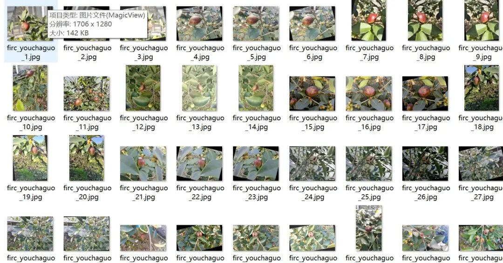
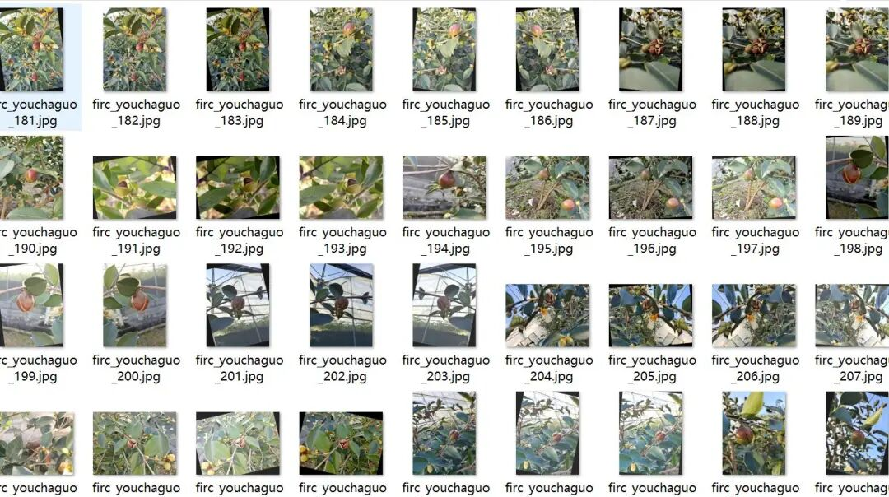
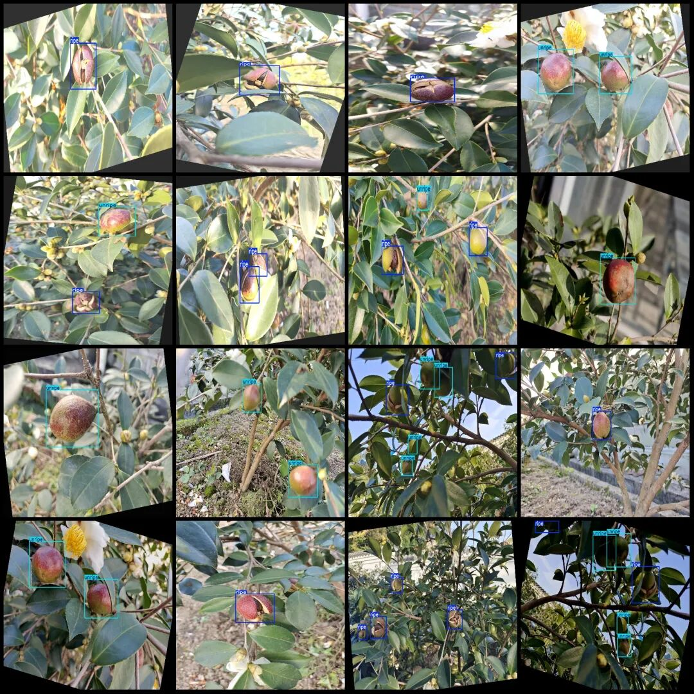
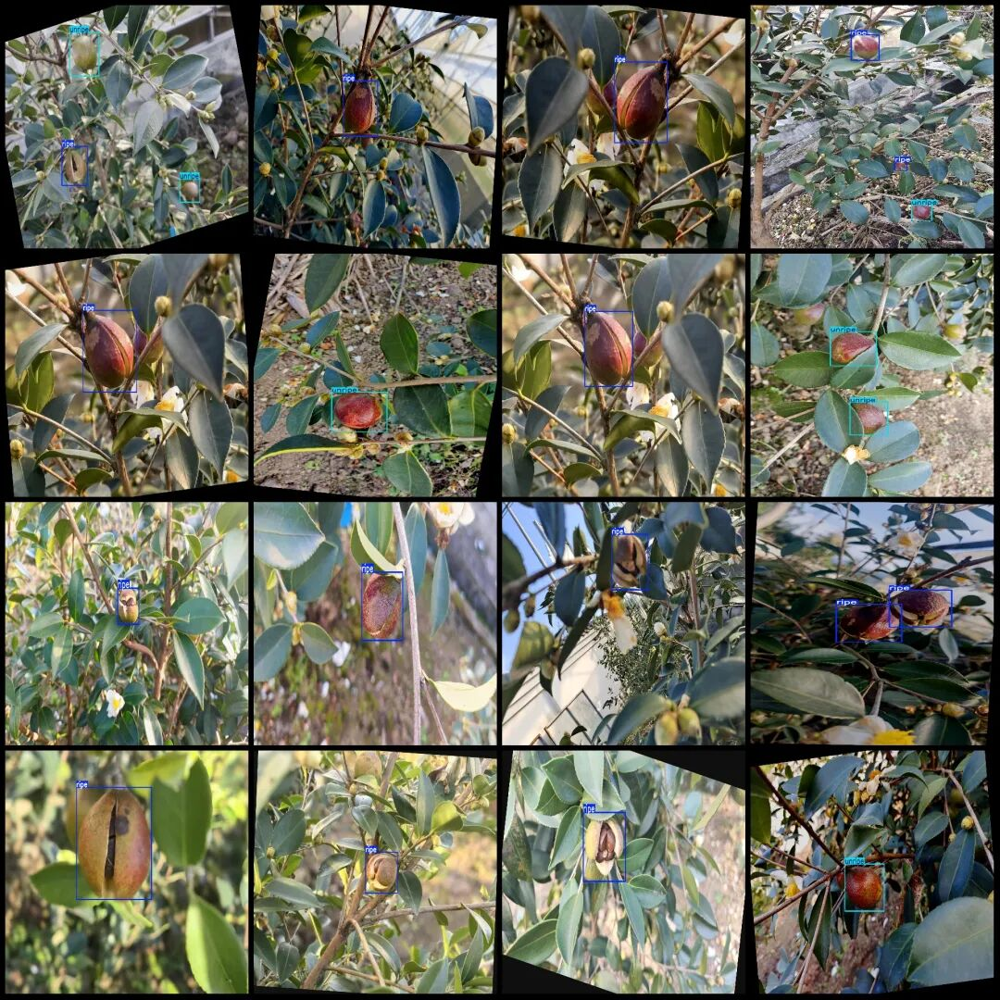

# Olive Oil Tea Fruit Maturity Detection Dataset VOC+YOLO format with 264 images in 2 categories

Please note that the 110 images in the dataset are originals, with the remaining being enhanced generated images, primarily through rotation enhancement algorithms.

Dataset format: Pascal VOC format + YOLO format (txt file without split path, only containing jpg images and corresponding VOC format xml files and yolo format txt files)

Number of images (number of jpg files): 264

Number of annotations (number of xml files): 264

Number of annotations (number of txt files): 264

Labeling category count: 2

Label category names (Note that the order of labels in the YOLO format does not correspond to this, but is based on the classes.txt file in the labels folder): ["ripe", "unripe"]

Number of boxes labeled in each category:

ripe frame count = 296

Unripe frame count = 206

Total frame count: 502

Number of images per category:

Ripe occupies the number of images = 200

Unripe occupies 127 images.

Image resolution: 2048x1536

Using labelImg:

Annotation rules: Draw a rectangle around the category.

Important Notice: The dataset does not have separate training, validation, and test sets; you need to partition them yourself.

Special : This dataset does not guarantee the accuracy of the trained models or weight files.

Image Preview:

Annotation example:

## Payment

Here is a pay link on Stripe ( https://buy.stripe.com/3cs8yP7sY87d0vu9AB ). Please contact me lonlonago@foxmail.com after funding $89, and I will send you a complete data files , thank you!

